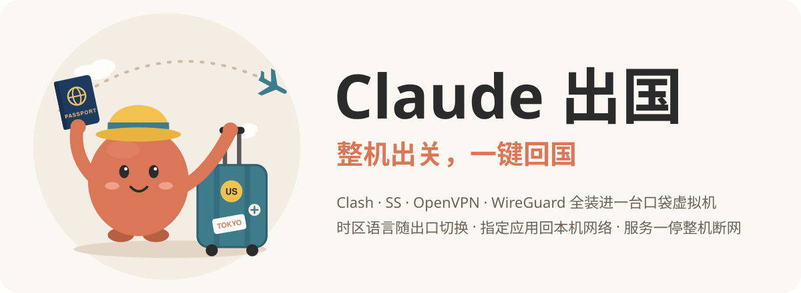

<div align="center">



**Take the whole Mac abroad: one main proxy carries all traffic, the network is cut if it fails, and one click brings you home.**

[简体中文](README.md) | English | [繁體中文](README.zh-TW.md) | [日本語](README.ja.md)

</div>

## What it is

Claude Abroad gives the whole Mac an "abroad network card": all traffic goes through a pocket-sized Alpine virtual machine and leaves through the **main proxy** you choose. Time zone and language follow the exit. If the service stops, the whole machine goes offline — it never silently falls back to a direct connection.

- **Main proxy**: chosen during setup. All traffic on the Mac uses it by default — TCP and DNS, and UDP when the node supports it. Supports Clash/Mihomo subscriptions, local YAML, manual HTTP/SOCKS5 nodes and chained proxies (relay → residential exit). It can be changed at any time on its own page.
- **Split exits (optional)**: OpenVPN, WireGuard or other subscriptions run inside the VM and are used only by the apps you assign, e.g. Chrome through a US WireGuard and the terminal through a Japanese node. With none installed, everything still goes through the main proxy.
- **Whole-machine coverage**: a virtual network interface takes over all TCP, UDP and DNS; there is no direct path around it.
- **Pocket VM**: a headless Alpine of about 100 MB with the proxy engines built in. Each VPN gets its own network namespace.
- **Per-app local network**: selected apps (e.g. messengers) can use the local network directly. Claude's domains are the exception: they never use the local network, whichever app asks.
- **LAN keeps working**: printers, NAS and router admin pages are allowed by default; this can be turned off.
- **Region sync**: after the main proxy's exit check passes, the VM's and the Mac's time zone and language switch together, and are restored afterwards.
- **Fail closed**: the pf firewall is the backstop. If the service stops, crashes or is disabled, or the main proxy fails its check, the machine stays offline until you click "Return home".
- **Native Mac app**: `Claude 出国.app`, written in Swift (SwiftUI), with a menu-bar icon for status and one-click enable, disable, restore local network and region switch.
- **Post-switch environment check**: 17 checks from the point of view of local apps: exit IP, time zone, language, IPv6, DNS, WebRTC (STUN), system proxy, where Claude traffic goes and whether it is reachable, and more. If a hard check fails, nothing is let through and Claude is not started; a temporarily unavailable lookup service does not cut the network by mistake.
- **Claude follows the switch**: the region only changes when you act. After confirmation Claude is force-quit and not reopened automatically; you click "Open Claude". After returning home, Claude cannot connect or start until a full uninstall.
- **One-click uninstall**: after a second confirmation it quits Claude, restores network and region, removes all controls, background services and data.
- **Sensitive actions need you**: returning home, uninstalling, changing the main proxy and moving an app to the local network all require Touch ID or the login password; scripts and other programs cannot do it for you.
- **Clear the field before returning home**: "Return home" asks for a second confirmation, then force-quits Claude Desktop, Claude Code and every other Claude process, and only restores the local network once they have all exited.

## Status

**Under development; there is no usable release yet.** The list above describes design goals, not shipped features.

- **macOS (14+, Apple Silicon)**: the VM, data plane, pf firewall rules, main proxy, exit checks and split exits (WireGuard, OpenVPN, Clash nodes) are implemented and pass unit tests and end-to-end tests inside the VM. Still to do: whole-system verification on real hardware, the native app UI, install and uninstall.
- **Windows (10/11 x64)**: started. Everything cross-compiles to Windows; the system layer currently refuses to run rather than letting traffic through. Work is in progress on the network-blocking rules based on the Windows Filtering Platform (WFP).

Documentation (in Chinese):

- [Introduction](docs/introduction.md)
- [Design](docs/design.md)
- [Windows design](docs/design-windows.md)
- [Progress](docs/PROGRESS.md)

## Building from source

Requires Go 1.26.

```sh
go build ./...
go vet ./...
go test ./internal/...
GOOS=linux GOARCH=arm64 go build ./...    # the parts that run inside the VM
GOOS=windows GOARCH=amd64 go build ./...  # Windows
```

Tests that need root, touch the real network or change system state are behind the `//go:build integration` tag and do not run by default.

## License

Released under the [MIT License](LICENSE). Code taken from other projects keeps its original license; see [NOTICE](NOTICE) and the `licenses/` directory.

## Acknowledgements and disclaimer

The design of the network gate, exit checks and VM network isolation draws on [Claude Cage](https://github.com/Lee-xeo/Claude-Cage) (MIT).

Claude Abroad is an independent community project. It is not affiliated with, endorsed by or authorized by Anthropic. "Claude" is a trademark of Anthropic. The mascot is an original illustration made for this project and is not an Anthropic character. This project does not provide proxy or VPN services and makes no promise to bypass any platform's risk controls or restrictions.
