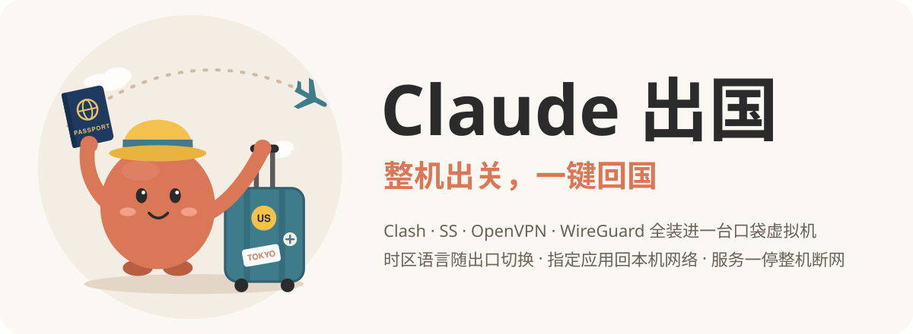
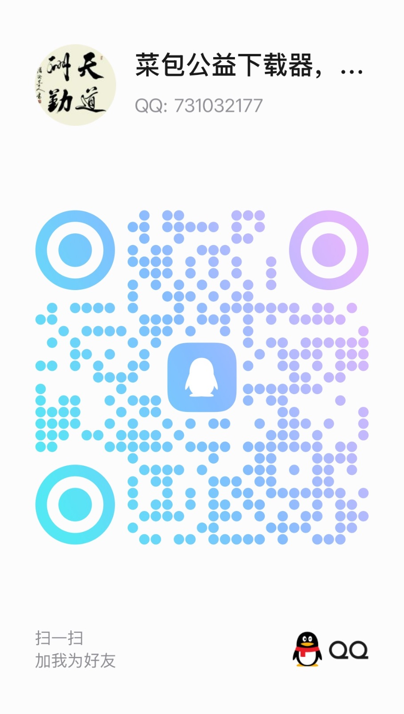

<div align="center">



**不换电脑、不开虚拟桌面、不装指纹浏览器 —— 让整台 Mac 一起出国。**

[](LICENSE)  

简体中文 | [English](README.en.md) | [繁體中文](README.zh-TW.md) | [日本語](README.ja.md)

</div>

> [!WARNING]
> **开发中，还没有可用的安装包。** 下文描述的是设计目标；哪些已经做完、哪些还在路上，见[项目状态](#项目状态)。

## 受够了 Anthropic

我们只是想好好用 Claude 写代码、聊天、干活。

可现实是：开个 VPS 当跳板，装个指纹浏览器，对着十几个检测网站一项项排查时区、语言、DNS、WebRTC、IPv6；Clash 规则写了一屏又一屏，还总有哪个后台进程偷偷走了直连；代理一断，Claude Code 拿着本机 IP 自动重连 —— 第二天收到一封"账号已停用"，订阅费打了水漂。

**受够了。**

所以有了 **Claude 出国**：一个装在 Mac 上的原生应用，给整台电脑插一块"出国网卡"。

- **你只需要一个靠谱的代理。** 导入订阅、选好节点，剩下的交给它。
- **整台 Mac 都在国外。** 不是某个浏览器、某个终端，而是所有应用、所有连接、所有 DNS —— 连时区和语言都跟着出口走。
- **断了就断网，绝不偷跑直连。** 代理挂了、服务崩了、检查没通过，Mac 直接断网，等你回来处理。宁可上不了网，也不让你的真实 IP 漏出去一个包。
- **想回来，一键回国。** 先清场、再恢复，网络、时区、语言全部还原。

你照样用你熟悉的 Claude 桌面版、终端里的 `claude`、平时的浏览器，什么都不用换。

## 为什么是"整机"

市面上的思路大多是"把 Claude 关进一个隔离环境"：开一台虚拟机桌面，在里面装浏览器、装 Claude、装开发工具。干净，但你得在两套系统之间来回切。

Claude 出国反过来：**不是把 Claude 关起来，而是把整台 Mac 送出去。**

| | 隔离环境的思路 | Claude 出国 |
|---|---|---|
| Claude 跑在哪 | 虚拟机桌面里 | 你自己的 Mac 上，原生运行 |
| 工具链 | 在虚拟机里重装一遍 | 直接用本机已有的 |
| 管住的流量 | 虚拟机里的 | 整台 Mac 的全部 TCP、UDP、DNS |
| 代理断了 | 虚拟机离线 | 整机断网，任何应用都漏不出去 |
| 微信、网银怎么办 | 本来就在外面 | 按应用放回本机网络（Claude 的域名例外，永远不走本机） |

背后是一台约 100 MB、没有图形界面的 Alpine 虚拟机：它只做一件事 —— 当你的出国网卡。你感觉不到它的存在。

## 它能做什么

**🌏 一个主代理，管住全部流量**
支持 Clash/Mihomo 订阅、本地 YAML、手动 HTTP/SOCKS5 节点，以及链式代理（中转 → 住宅出口）。TCP、DNS 全部从它出去；节点支持 UDP 时 UDP 也走它，不支持就拦下，绝不改走直连。

**🔀 想分流？按应用指定出口**
OpenVPN、WireGuard、其他订阅都可以装进虚拟机，只给指定的应用用：Chrome 走美国 WireGuard，终端走日本节点。每个 VPN 都有独立的网络命名空间，互不干扰。一个不装也完全没问题。

**🕐 时区和语言跟着出口走**
出口检查通过后，Mac 的时区和语言一起切到出口所在地；回国时还原成原来的样子。而且地区是锁定的，节点 IP 漂移不会悄悄改你的时区。

**🧪 17 项出国后体检**
从本机应用的视角检查出口 IP、时区、语言、IPv6、DNS、WebRTC（STUN）、系统代理、Claude 的去向与可达性……硬性项不通过就不放行、不让 Claude 启动。查询服务临时抽风不会误判断网。

**🛡️ 断服即断网**
pf 防火墙兜底：服务停止、崩溃、停用，或主代理检查不通过，Mac 都保持断网。只有你亲手点"一键回国"才恢复本机网络。

**🧹 回国先清场**
点"一键回国"后，先强制结束 Claude 桌面版、Claude Code 等所有 Claude 进程，确认全部退出才恢复本机网络 —— 不给它们拿本机 IP 重连的机会。回国状态下 Claude 也启动不了，防止开机自启、手滑误开。

**🔐 关键操作要你本人点头**
回国、卸载、换主代理、把应用放回本机网络，都要 Touch ID 或登录密码。脚本和别的程序没法替你按。

**🖨️ 局域网照常用**
打印机、NAS、路由器后台默认放行，不想要可以关。

**🍎 原生 Mac 应用**
SwiftUI 写的 `Claude 出国.app`，菜单栏常驻，状态一眼看清。启用、停用、回国、切换地区、一键卸载，全部点一下就行。

## 项目状态

| 平台 | 进度 |
|---|---|
| **macOS 14+（Apple Silicon）** | 虚拟机、数据面、pf 防火墙规则、主代理、出口检查、分流出口（WireGuard、OpenVPN、Clash 节点）已完成，通过单元测试和虚拟机里的端到端测试。还差：真机整体验证、原生应用界面、安装与卸载。 |
| **Windows 10/11 x64** | 已开工。全部代码可编译为 Windows 版本，系统层暂时一律报错退出、不会放行；正在做基于 Windows 筛选平台（WFP）的断网规则。 |

想第一时间用上？点个 ⭐ Star 关注发布。

## 你唯一需要准备的

**一个靠谱的代理节点。** 本项目不提供、也不推荐任何代理或 VPN 服务，请自行解决。

## 从源码构建

需要 Go 1.26。

```sh
go build ./...
go vet ./...
go test ./internal/...
GOOS=linux GOARCH=arm64 go build ./...    # 虚拟机里运行的部分
GOOS=windows GOARCH=amd64 go build ./...  # Windows
```

需要 root、会碰真实网络或改系统状态的测试放在 `//go:build integration` 标签下，默认不跑。

## 文档

| 想了解 | 看这里 |
|---|---|
| 它是怎么工作的、复用了哪些代码 | [项目介绍](docs/introduction.md) |
| 完整设计、里程碑、待验证的风险 | [技术方案](docs/design.md) |
| Windows 的做法 | [Windows 方案](docs/design-windows.md) |
| 做到哪了 | [进度单](docs/PROGRESS.md) |

## 交流与反馈

项目还在快速迭代，欢迎提 [Issue](https://github.com/seven9999997/claude-abroad/issues) 和 PR，也欢迎加 QQ 或进群聊需求、报问题，一起把它做好。

| QQ：731032177 | QQ 群：801350116 |
| :---: | :---: |
| <a href="assets/contact-qq.jpg"></a> | <a href="assets/contact-qq-group.jpg"></a> |

## 赞助

Claude 出国完全免费、开源，由个人在业余时间开发维护。如果它帮你省下了折腾环境的时间，或者让你少担一次封号的心，欢迎请作者喝杯咖啡 ☕ 你的支持会用在真机测试设备和后续开发上。

赞助完全自愿，不附带任何功能或服务承诺。

<p align="center">
  <a href="assets/sponsor-wechat-reward.jpg"></a>
</p>

## 使用前请了解

- Claude 出国管的是**网络和地区环境**，不是魔法。环境检测展示的是当前配置和采样证据，**不能保证账号不会受到任何平台限制**。
- 启用后整机流量都经过你选的代理，代理的速度和稳定性直接决定你的上网体验。
- 主代理不支持 UDP 时，UDP 会被拦截：浏览器会自动退回 TCP，但视频会议、语音通话、游戏可能用不了。

## 许可证

本项目以 [MIT 许可证](LICENSE) 发布。来自其他项目的代码保留原有许可证，见 [NOTICE](NOTICE) 和 `licenses/` 目录。mihomo、sing-box（GPL-3.0）和 OpenVPN（GPL-2.0）作为独立程序在虚拟机内运行，不链接进本项目代码。

## 致谢与声明

网络闸门、出口检查和虚拟机网络隔离的设计参考并复用了 [Claude Cage](https://github.com/Lee-xeo/Claude-Cage)（MIT）的代码 —— 感谢 Cage 先把路趟出来。

Claude 出国是独立的社区项目，与 Anthropic 没有任何关联，也没有得到 Anthropic 的认可或授权。"Claude"是 Anthropic 的商标。吉祥物是本项目原创的插画，并非 Anthropic 的形象。本项目不提供代理或 VPN 服务，也不承诺规避任何平台的风控或限制。
