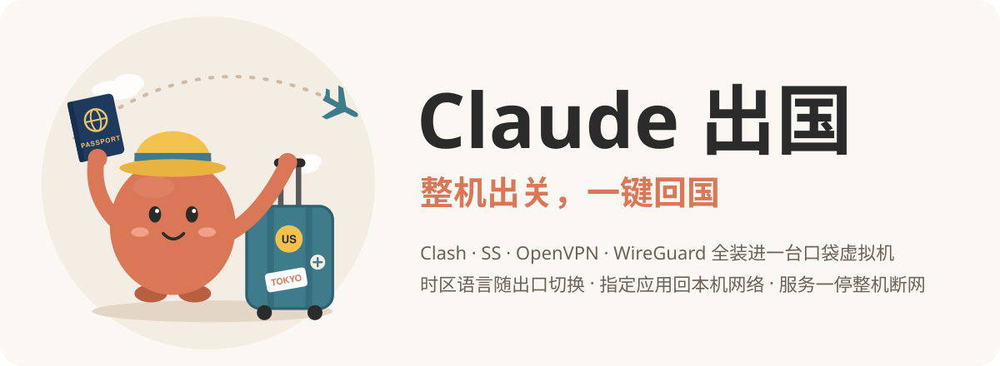
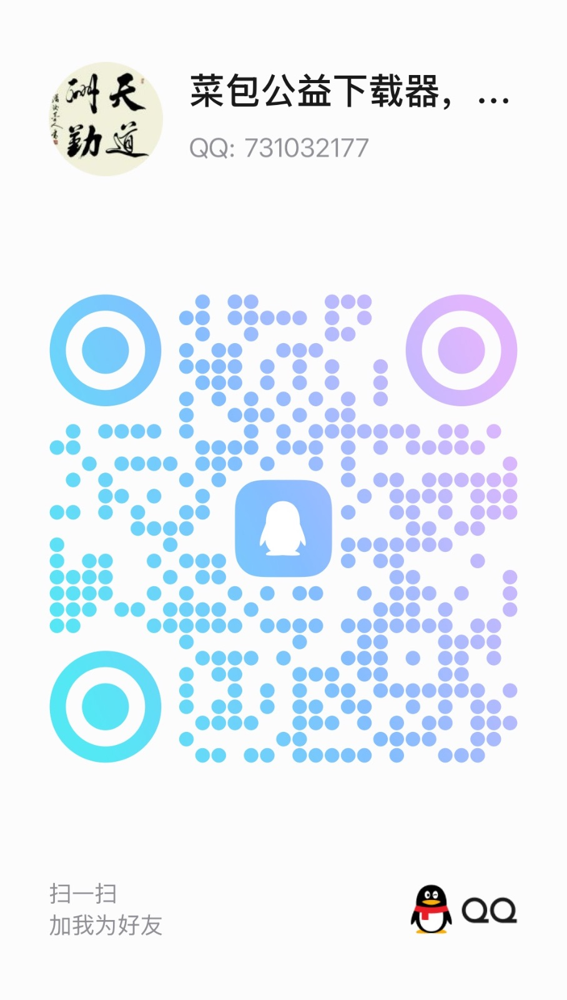

<div align="center">



**不換電腦、不開虛擬桌面、不裝指紋瀏覽器 —— 讓整台 Mac 一起出國。**

[](https://github.com/seven9999997/claude-abroad/actions/workflows/ci.yml) [](LICENSE)  

[简体中文](README.md) | [English](README.en.md) | 繁體中文 | [日本語](README.ja.md)

</div>

> [!WARNING]
> **開發中，還沒有可用的安裝包。** 下文描述的是設計目標；哪些已經做完、哪些還在路上，見[專案狀態](#專案狀態)。

## 受夠了 Anthropic

我們只是想好好用 Claude 寫程式、聊天、做事。

可現實是：開個 VPS 當跳板，裝個指紋瀏覽器，對著十幾個檢測網站一項項排查時區、語言、DNS、WebRTC、IPv6；Clash 規則寫了一屏又一屏，還總有哪個背景行程偷偷走了直連；代理一斷，Claude Code 拿著本機 IP 自動重連 —— 隔天收到一封「帳號已停用」，訂閱費打了水漂。

**受夠了。**

所以有了 **Claude 出國**：一個裝在 Mac 上的原生應用程式，給整台電腦插一塊「出國網卡」。

- **你只需要一個靠譜的代理。** 匯入訂閱、選好節點，剩下的交給它。
- **整台 Mac 都在國外。** 不是某個瀏覽器、某個終端機，而是所有應用程式、所有連線、所有 DNS —— 連時區和語言都跟著出口走。
- **斷了就斷網，絕不偷跑直連。** 代理掛了、服務當了、檢查沒通過，Mac 直接斷網，等你回來處理。寧可上不了網，也不讓你的真實 IP 漏出去一個封包。
- **想回來，一鍵回國。** 先清場、再還原，網路、時區、語言全部恢復。

你照樣用你熟悉的 Claude 桌面版、終端機裡的 `claude`、平時的瀏覽器，什麼都不用換。

## 為什麼是「整機」

市面上的思路大多是「把 Claude 關進一個隔離環境」：開一台虛擬機桌面，在裡面裝瀏覽器、裝 Claude、裝開發工具。乾淨，但你得在兩套系統之間來回切。

Claude 出國反過來：**不是把 Claude 關起來，而是把整台 Mac 送出去。**

| | 隔離環境的思路 | Claude 出國 |
|---|---|---|
| Claude 跑在哪 | 虛擬機桌面裡 | 你自己的 Mac 上，原生執行 |
| 工具鏈 | 在虛擬機裡重裝一遍 | 直接用本機已有的 |
| 管住的流量 | 虛擬機裡的 | 整台 Mac 的全部 TCP、UDP、DNS |
| 代理斷了 | 虛擬機離線 | 整機斷網，任何應用程式都漏不出去 |
| 微信、網銀怎麼辦 | 本來就在外面 | 按應用程式放回本機網路（Claude 的網域例外，永遠不走本機） |

背後是一台約 100 MB、沒有圖形介面的 Alpine 虛擬機：它只做一件事 —— 當你的出國網卡。你感覺不到它的存在。

## 它能做什麼

**🌏 一個主代理，管住全部流量**
支援 Clash/Mihomo 訂閱、本機 YAML、手動 HTTP/SOCKS5 節點，以及鏈式代理（中轉 → 住宅出口）。TCP、DNS 全部從它出去；節點支援 UDP 時 UDP 也走它，不支援就攔下，絕不改走直連。

**🔀 想分流？按應用程式指定出口**
OpenVPN、WireGuard、其他訂閱都可以裝進虛擬機，只給指定的應用程式用：Chrome 走美國 WireGuard，終端機走日本節點。每個 VPN 都有獨立的網路命名空間，互不干擾。一個不裝也完全沒問題。

**🕐 時區和語言跟著出口走**
出口檢查通過後，Mac 的時區和語言一起切到出口所在地；回國時還原成原來的樣子。而且地區是鎖定的，節點 IP 漂移不會悄悄改你的時區。

**🧪 17 項出國後體檢**
從本機應用程式的視角檢查出口 IP、時區、語言、IPv6、DNS、WebRTC（STUN）、系統代理、Claude 的去向與可達性……硬性項不通過就不放行、不讓 Claude 啟動。查詢服務臨時出狀況不會誤判斷網。

**🛡️ 斷服即斷網**
pf 防火牆兜底：服務停止、當掉、停用，或主代理檢查不通過，Mac 都保持斷網。只有你親手點「一鍵回國」才恢復本機網路。

**🧹 回國先清場**
點「一鍵回國」後，先強制結束 Claude 桌面版、Claude Code 等所有 Claude 行程，確認全部退出才恢復本機網路 —— 不給它們拿本機 IP 重連的機會。回國狀態下 Claude 也啟動不了，防止開機自啟、手滑誤開。

**🔐 關鍵操作要你本人點頭**
回國、解除安裝、換主代理、把應用程式放回本機網路，都要 Touch ID 或登入密碼。腳本和別的程式沒辦法替你按。

**🖨️ 區域網路照常用**
印表機、NAS、路由器後台預設放行，不想要可以關。

**🍎 原生 Mac 應用程式**
SwiftUI 寫的 `Claude 出国.app`，選單列常駐，狀態一眼看清。啟用、停用、回國、切換地區、一鍵解除安裝，全部點一下就行。

## 專案狀態

| 平台 | 進度 |
|---|---|
| **macOS 14+（Apple Silicon）** | 虛擬機、資料面、pf 防火牆規則、主代理、出口檢查、分流出口（WireGuard、OpenVPN、Clash 節點）已完成，通過單元測試和虛擬機裡的端到端測試。還差：實機整體驗證、原生應用程式介面、安裝與解除安裝。 |
| **Windows 10/11 x64** | 已開工。全部程式碼可編譯為 Windows 版本，系統層暫時一律報錯退出、不會放行；正在做基於 Windows 篩選平台（WFP）的斷網規則。 |

想第一時間用上？點個 ⭐ Star 關注發布。

## 你唯一需要準備的

**一個靠譜的代理節點。** 本專案不提供、也不推薦任何代理或 VPN 服務，請自行解決。

## 從原始碼建置

需要 Go 1.26。

```sh
go build ./...
go vet ./...
go test ./internal/...
GOOS=linux GOARCH=arm64 go build ./...    # 虛擬機裡執行的部分
GOOS=windows GOARCH=amd64 go build ./...  # Windows
```

需要 root、會碰真實網路或改系統狀態的測試放在 `//go:build integration` 標籤下，預設不跑。

## 文件（簡體中文）

| 想了解 | 看這裡 |
|---|---|
| 它是怎麼運作的、重用了哪些程式碼 | [專案介紹](docs/introduction.md) |
| 完整設計、里程碑、待驗證的風險 | [技術方案](docs/design.md) |
| Windows 的做法 | [Windows 方案](docs/design-windows.md) |
| 做到哪了 | [進度單](docs/PROGRESS.md) |

## 交流與回饋

專案還在快速迭代，歡迎提 [Issue](https://github.com/seven9999997/claude-abroad/issues) 和 PR，也歡迎加 QQ 或進群聊需求、回報問題，一起把它做好。

| QQ：731032177 | QQ 群：801350116 |
| :---: | :---: |
| <a href="assets/contact-qq.jpg"></a> | <a href="assets/contact-qq-group.jpg"></a> |

## 使用前請了解

- Claude 出國管的是**網路和地區環境**，不是魔法。環境檢測展示的是目前設定和取樣證據，**不能保證帳號不會受到任何平台限制**。
- 啟用後整機流量都經過你選的代理，代理的速度和穩定性直接決定你的上網體驗。
- 主代理不支援 UDP 時，UDP 會被攔截：瀏覽器會自動退回 TCP，但視訊會議、語音通話、遊戲可能用不了。

## 授權

本專案以 [MIT 授權條款](LICENSE) 發布。來自其他專案的程式碼保留原有授權，見 [NOTICE](NOTICE) 和 `licenses/` 目錄。mihomo、sing-box（GPL-3.0）和 OpenVPN（GPL-2.0）作為獨立程式在虛擬機內執行，不連結進本專案程式碼。

## 致謝與聲明

網路閘門、出口檢查和虛擬機網路隔離的設計參考並重用了 [Claude Cage](https://github.com/Lee-xeo/Claude-Cage)（MIT）的程式碼 —— 感謝 Cage 先把路趟出來。

Claude 出國是獨立的社群專案，與 Anthropic 沒有任何關聯，也沒有得到 Anthropic 的認可或授權。「Claude」是 Anthropic 的商標。吉祥物是本專案原創的插畫，並非 Anthropic 的形象。本專案不提供代理或 VPN 服務，也不承諾規避任何平台的風控或限制。
